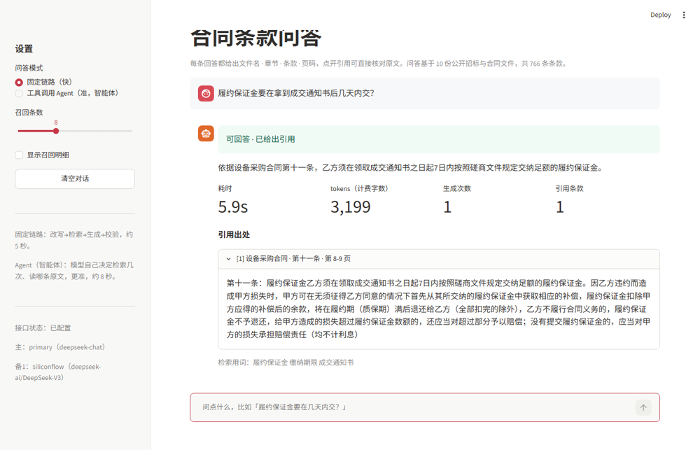
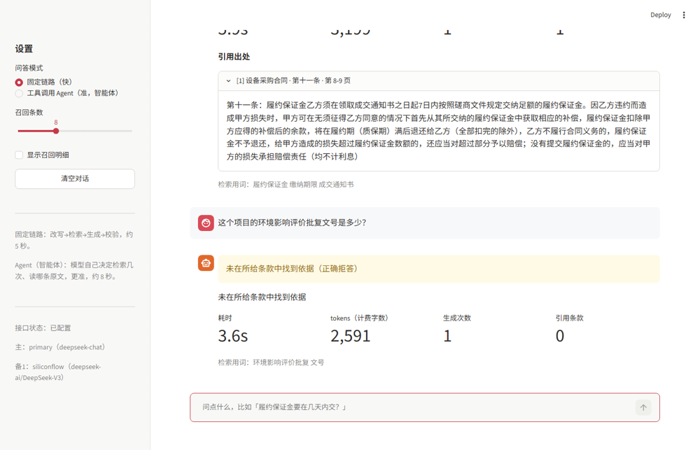
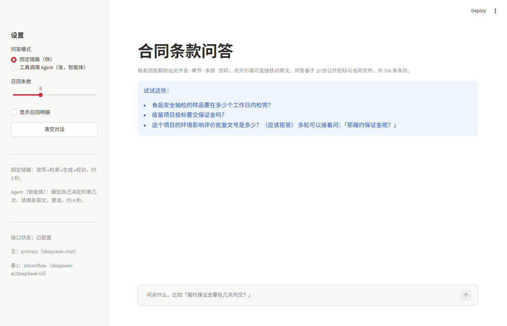

# 合同条款智能问答

一个**引用可核对**的合同问答系统。核心不是「能答」，而是「答得能被逐字核对」：
每条回答都必须给出它出自哪份文件、哪一章、哪一条、第几页。



两种跑法，同一套引用校验（100 道种子题：72 可答 / 28 不可答）：

| 路径 | 做法 | 双正确 | 拒答 | 耗时 |
|---|---|---|---|---|
| 默认 | 固定五节点链路（route→rewrite→retrieve→generate→verify） | 89% | 89% | 4.57s |
| `--agent` | 工具调用：模型自己决定检索几次、读哪几条原文，再交卷 | **93%** | **96%** | 8.38s |

和常见 RAG demo 差别在三点：切分以条款为最小单位（不是按字数切）、
检索用 BM25 + 向量双路加权融合（不是只用向量）、引用带页码可翻页验证（不是只报文件名）。

> 命名：仓库名为 `Contract-qa-RAG`。加完工具调用后，`--agent` 那条路径确实由模型自主决定
> 检索策略与何时交卷，够得上「Agent」；默认路径仍是固定链路。两者共用同一套引用校验，
> 数据见 `docs/eval-e2e.md` 与 `docs/eval-agent.md`。

## 当前状态

**D4：主链路改为状态机。** route（判断问题是否属于合同域）→ rewrite（改写查询、拆复合问题）
→ retrieve（双路召回 + RRF）→ generate（严格 JSON，malformed 自动重试一次）。
节点级降级：任一接口调用失败都会按预设路径继续（放行 / 退回原句 / 输出降级答案），
引用不一致（候选外引用、可答但无引用等）会标记「需要人工复核」而非静默输出。
冒烟结果见 `docs/smoke.md`，解析验收见 `docs/parse-acceptance.md`。

**D5：检索评测与重排。** 50 条种子题（fact 18 / cross 17 / unanswerable 15）测 Recall@5：
仅 BM25 80%、仅向量 89%、混合 RRF 89%、混合 + rerank 89%（默认权重 1:1）。
切分规整：569 → 766 条，>500 字条款清零、极短条目归并，页码区域命中 94.0% 持平。
三个发现：① 默认权重比 2:1 超过 RRF 的压制阈值 1.31，会把单路命中的答案挤到 20 名外；
② rerank 四轮零召回增益，只能重排池内条款；③ 四道边界题（同构表格、表格碎片、标题正文被切断），
需字段级结构化抽取才能解决。数据见 `docs/eval-d5.md`，分析见 `docs/d5-findings.md`。重排默认关闭。

**D6：引用校验与回退。** 生成后加 verify 节点：先跑零成本规则校验（可答却没引用、
引用不在候选里、答案为空），再让模型核对答案是否被引用条款支持。
不通过带上问题说明回退重生成，最多 2 轮；校验接口本身失败时放行并记入 node_errors。
冒烟 3 题：2 题可答且引用正确、1 题正确拒答，均一次通过，可答题均耗时约 5.3 秒
（verify 的模型校验约 1 秒，拒答题不触发模型校验）。
记录见 `docs/d6-smoke.md`。

进度：D1 骨架 ✓ · D2 解析与切分 ✓ · D3 索引与检索 ✓ · D4 四节点主链路 ✓
· D5 检索评测 ✓ · D6 引用校验 ✓ · E1 端到端评测 ✓ · E2 工具调用 Agent ✓

**E1：端到端评测。** 50 道种子题全跑一遍主链路（35 可答、15 不可答）：

| 指标 | 结果 |
|---|---|
| 双正确（答案对且引用对） | **32/35 = 91%** |
| 拒答准确（不可答） | **14/15 = 93%** |
| 硬答 | 1 题（问「评标专家都有谁」，答了组成规则） |
| verify 触发 | 2 题（Q02、Q07 各回退一次后通过） |
| 平均耗时 / P95 | 4.76s / 6.48s |
| 平均 tokens | 3350 |

关键发现：第一轮跑出来只有 77%，诊断发现 **7 道题答案就在候选里、模型却拒答**——
多条款汇总、跨文件对比、口语指代（「这个平台」）都会触发保守拒答。
在生成提示里补三条规则后升到 91%，剩余 3 道失败全部是 D5 已知的检索边界题（Q20/Q24）。数据见 `docs/eval-e2e.md`。

**E2：工具调用 Agent。** 新增 `agent.py`：4 个工具（`search_clauses` / `read_clause` /
`read_neighbors` / `answer`），模型自己决定检索几次、换什么说法、读哪条原文，最多 6 轮后交卷，
交卷后仍走同一套引用校验。`contract-qa ask "..." --agent` 可用。

同一批 36 道可答题 + 14 道不可答题对比：

| 指标 | 固定链路 | Agent |
|---|---|---|
| 双正确 | 89%（32/36） | **94%（34/36）** |
| 拒答准确 | 93%（13/14） | **100%（14/14）** |
| 平均耗时 | 4.67s | 7.69s |
| 平均 tokens | 3,350 | 13,771 |

Agent 修好了固定链路的两道边界题（Q24 疫苗保证金、Q25 服务期）：它可以换三种说法反复搜、
按 clause_id 读原文，把「一次召回定生死」的风险摊薄。代价是慢 65%、贵 4 倍。
默认仍走固定链路，`--agent` 按需开启。数据见 `docs/eval-agent.md`。

**E3：评测集扩到 100 题。** 50 题不足以排除小样本波动，扩到 100 题（fact 40 / cross 32 / unanswerable 28），
答案条款全部逐条核对自 10 份文档的原文，判定关键词独立标注。扩规模后指标基本持平：

| 指标 | 50 题 | 100 题 |
|---|---|---|
| 检索 Recall@5（混合） | 89% | 88% |
| 固定链路双正确 | 89% | 89% |
| Agent 双正确 | 94% | 93% |
| Agent 拒答准确 | 100% | 96% |

结论：50 题的数字不是小样本侥幸，跨规模稳定。新题额外暴露了「同一事实在正文与前附表重复出现、
单一 clause_id 标注会冤枉模型」的判定问题，已把等价条款补进标注（诚实反映模型答对的事实）。

## 多供应商与降级

对话接口支持主备供应商，主供应商接口失败时自动切换，不用改代码：

```bash
# .env
LLM_API_KEY=...                      # 主
LLM_FALLBACK_API_KEY=...             # 备（可再配 LLM_FALLBACK_2_*）
LLM_FALLBACK_BASE_URL=https://api.siliconflow.cn/v1
LLM_FALLBACK_MODEL=deepseek-ai/DeepSeek-V3
```

- 只对**接口失败**切换（401 密钥无效、402 余额不足、429 限流、5xx、超时）；
  答案内容不合格不会触发换模型，避免把质量问题掩盖成「换一家再答」
- 结果里记录实际使用的供应商名；`contract-qa check` 会列出主备配置
- 备用模型需支持 JSON 输出；用 `--agent` 时还需支持 tools（工具调用）

## 界面

```powershell
uv run streamlit run src/contract_qa/app.py
```

打开 `http://localhost:8501`：

- 侧栏切换「固定链路 / 工具调用 Agent」，调召回条数、勾选召回明细
- 回答下方直接列出耗时、tokens、引用数
- 每条引用展开可见条款原文与页码，点一条核对一条
- 支持多轮追问：问「履约保证金几天内交」后接「那投标保证金呢」，
  指代会被替换成具体对象再检索（实测检索词由「金额」变为「疫苗项目 投标保证金 金额」）
- 接口失败会标明原因（密钥无效、余额不足、索引缺失），不静默降级





## 文档

| 文档 | 内容 |
| --- | --- |
| [docs/why-custom-splitter.md](docs/why-custom-splitter.md) | 为什么不用现成切分器：对照实验、真实样例、代价与适用边界 |
| [docs/problems/](docs/problems/) | D1–D3 的 16 个真实卡点：现象、原因、处理、教训（PDF） |
| [docs/parse-acceptance.md](docs/parse-acceptance.md) | 解析与切分的抽样验收（766 条条款、页码命中 94.0%） |
| [docs/splitter-comparison.md](docs/splitter-comparison.md) | 现成切分工具与本项目切分器的对照数据 |
| [docs/smoke.md](docs/smoke.md) | D4 冒烟记录（6 题、路由、改写查询、耗时、token） |
| [docs/d6-smoke.md](docs/d6-smoke.md) | D6 冒烟记录（verify 轮次、引用、耗时拆解、未覆盖路径） |
| [docs/d6-verify-overview.pdf](docs/d6-verify-overview.pdf) | D6 说明文档（PDF）：链路位置、三类错误、两层校验、回退与代价 |
| [docs/eval-e2e.md](docs/eval-e2e.md) | E1 端到端评测：答案正确率、引用命中、拒答准确率、verify 触发、逐题明细 |
| [docs/eval-agent.md](docs/eval-agent.md) | E2 工具调用 Agent 评测：同批 50 题的对比数据与失败明细 |
| [docs/project-summary.md](docs/project-summary.md) | 项目成果一页纸：问题、方案、实测指标、三次负结果与取舍（另有同名 PDF） |
| [docs/eval-d5.md](docs/eval-d5.md) | D5 检索评测：四组对照、逐题名次、权重扫描、耗时 |
| [docs/d5-findings.md](docs/d5-findings.md) | D5 结论：RRF 压制阈值、rerank 边界、样本量限制 |
| [docs/mvp-scope.md](docs/mvp-scope.md) | 范围边界：做什么、不做什么、为什么 |

## MVP

- PDF 入库与条款级切分：已完成
- BM25 + 向量混合检索、RRF 融合：已完成
- 单文档问答与强制条款引用：已完成
- 路由、查询改写、复合问题拆解：已完成
- 重排（rerank）与引用校验、最多 2 轮回退：进行中
- 60 条离线评测集与指标报告
- Streamlit 溯源界面

明确不做：扫描件 OCR 全流程、法律意见生成、多人权限、移动端、自建向量数据库集群。
边界理由见 `docs/mvp-scope.md`。

## 快速开始

要求 Python 3.11+ 与 uv。

```bash
uv sync
cp .env.example .env      # 填入 LLM 与 Embedding 密钥
uv run contract-qa check  # 环境与数据检查
uv run contract-qa parse  # PDF -> 条款（输出 data/processed/*.jsonl）
uv run contract-qa index  # 建 BM25 与向量索引
uv run contract-qa ask "宁国市垃圾中转站项目的合同总价是多少？"
uv run pytest
uv run ruff check .
```

未安装 uv 时，纯标准库路径同样可跑通（除向量检索外）：

```bash
PYTHONPATH=src python -m contract_qa check
PYTHONPATH=src python -m contract_qa parse
python -m unittest discover -s tests -v
```

`ask` 支持 `--top-k`（送入模型的条款数，默认 8）与 `--show-hits`（打印双路召回排名与融合分）。

## 模型配置

DeepSeek 只提供对话模型，没有 Embedding 接口，因此需要两家服务：

| 用途 | 服务 | 默认模型 |
| --- | --- | --- |
| 问答生成 | DeepSeek | `deepseek-chat` |
| 向量化 | 硅基流动（OpenAI 兼容） | `BAAI/bge-m3`（1024 维） |

密钥写入 `.env`，该文件已被 `.gitignore` 排除，不会进入版本库。

## 数据

15 份公开政府采购文件（10 份合同 + 5 份招标文件，共 635 页），来源为中国政府采购网、
北京市政府采购网、河南省政府采购网及各地公共资源交易中心。元数据见 `data/document-register.csv`，
下载脚本 `scripts/fetch_public_documents.py`。

其中 5 份为纯扫描件（无可抽取文本），刻意保留为解析失败样本，不参与切分。
PDF 原文不进版本库。

## 目录

```text
src/contract_qa/
  text.py           PDF 取文、页眉页脚与目录清洗、标题分级
  splitter.py       条款切分（article / outline / chunk 三种模式）
  parse.py          解析编排与 JSONL 输出
  index.py          BM25 与 Chroma 向量索引
  retrieval.py      双路召回 + 加权 RRF 融合
  graph.py          五节点状态机（route/rewrite/retrieve/generate/verify）
  llm.py            OpenAI 兼容客户端（向量化 + 对话）
  config.py         .env 加载与配置聚合（密钥、路径、检索权重）
  cli.py            命令行入口
scripts/            数据获取、验收与冒烟测试
tests/              自动化测试
docs/               范围、设计与验收记录
data/raw/           原始 PDF（不入库）
data/processed/     条款、索引与产物（不入库）
```

## 切分规则

条款单元按文档自身的编号体系选择，不强行统一：

- **article**：`第X条` 出现 8 次以上，按条切，章/节写入 `chapter_path`
- **outline**：靠 `一、` / `（一）` / `1、` / `1.1` 分层，从最粗的编号层往下试切，
  取第一条「中位长度落在 60–700 字符」的层级
- **chunk**：没有稳定编号，按 700 字符窗口切，强制带页码

三条硬约束：目录页整页丢弃（否则会留下「第一章」三个字的残行污染章节路径）；
只有标题没有正文的条目并入下一条；超过 500 字符的条款按标点切开，片段继承
父条款编号并写入 `parent_clause_id`；带编号的单行极短条目（<40 字）并入相邻条款。

## 检索策略

双路召回后用加权 RRF 融合，权重可用 `BM25_WEIGHT` / `DENSE_WEIGHT` 调
（写入 `.env` 或进程环境变量均可，默认 1.0 / 1.0；非法值会直接报错而不是静默生效）。

默认 1:1 是 D5 三轮评测的实测结论：权重比超过约 1.31 时，权重高的一路的长尾
会压过另一路的头部，把单路命中的答案挤出候选池（Q06 实测：向量第 1 名被
BM25 第 20 名压制到融合第 21 名）。向量负责语义泛化，关键词负责术语命中。

## 指标纪律

Recall@5、引用正确率、不可答硬答率、P95 延迟与成本只记录实测结果。
计划书中的数字仅是示例，不得直接写入简历或 README。

## 下一步

D6 已完成（verify 节点）。下一步二选一：
- **结构化抽取**：PDF 表格重建（`find_tables`）+ 子合同分段，修 D5 的四道边界题
- **工具调用**：把检索/比对/翻页做成可调工具，才够得上「Agent」这个词

D5 留下的待办：
- 四道边界题（Q20/Q24/Q34/Q43）：字段级切分与 PDF 表格还原都试过、都回滚了（`docs/d5-findings.md` 第四、五节），
  根因是「条款为引用单元」与「字段级定位」的冲突，不再重复尝试
- rerank 待召回进一步修好后再复评

当前基线：766 条条款、检索 Recall@5 88%（混合 1:1）、D6 冒烟 3 题（2 可答 / 1 正确拒答）。
可答题端到端约 5.3 秒，其中 verify 的模型校验约 1 秒。

链路从 D3 的单次检索变成四节点后，平均耗时从 1.84 秒升到 3.65 秒——多出来的两次 LLM 调用
（route 与 rewrite）换来的是：无关问题 1.15 秒直接短路不检索、复合问题能拆成两问分别召回。
D6 再加一次 verify 调用，可答题约再多 1 秒，换的是引用可核对。

## License

MIT
